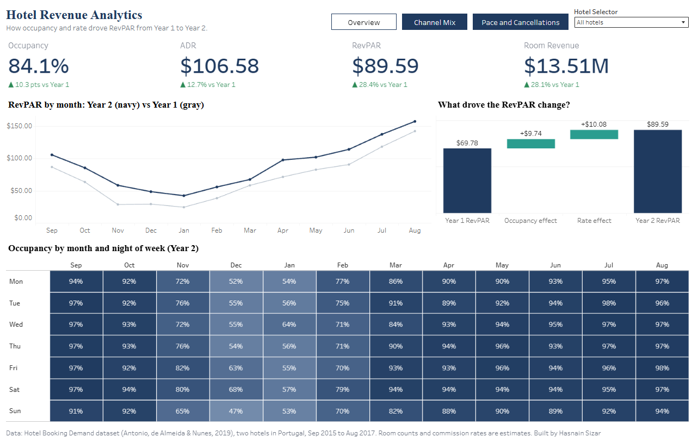
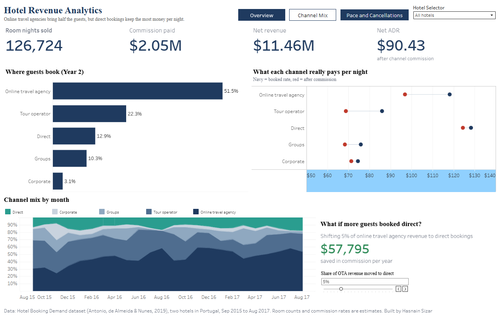
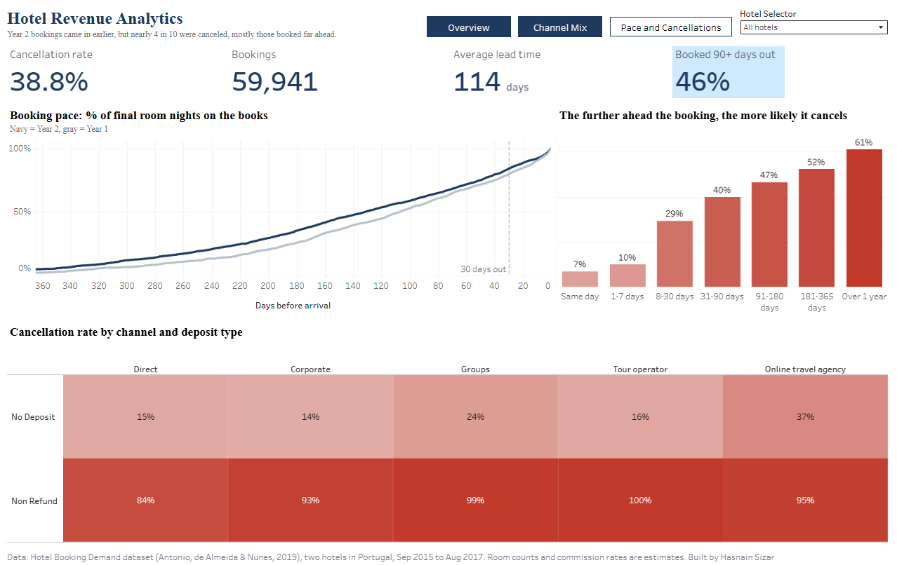

# Hotel Revenue Analytics

An interactive Tableau dashboard that answers three questions a hotel revenue team asks every week:

1. **Revenue:** How did revenue per available room (RevPAR) change, and was it driven by more guests or higher rates?
2. **Channels:** Which booking channels bring guests in, and what do they really pay after commission?
3. **Pace and cancellations:** How far ahead do guests book, and which bookings are likely to cancel?

**Live dashboard:** [View on Tableau Public](https://public.tableau.com/app/profile/hasnain.sizar/viz/HotelRevenueAnalytics_17955572469610/Overview)

More pages

## Open the workbook

Download [`tableau/HotelRevenueAnalytics.twbx`](tableau/HotelRevenueAnalytics.twbx) and open it in [Tableau Public](https://www.tableau.com/products/public/download) (free) or Tableau Desktop. The data is packaged inside the workbook, so no extra setup is needed. Or [view it live on Tableau Public](https://public.tableau.com/app/profile/hasnain.sizar/viz/HotelRevenueAnalytics_17955572469610/Overview).

## Key findings (Year 2 vs Year 1, both hotels)

- **RevPAR grew 28%**, from $69.78 to $89.59. The gain split almost evenly between higher occupancy (+$9.74) and higher rates (+$10.08).
- **Online travel agencies bring 52% of room nights** but pay about $97 a night after commission, compared with about $124 for direct bookings. Moving 5% of that revenue to direct would save about $58K a year in commission.
- **39% of bookings cancel.** Cancellation risk climbs with lead time: 7% for same-day bookings vs 61% for bookings made more than a year out.
- **Guests booked earlier in Year 2:** 84% of final room nights were on the books 30 days before arrival, up from 80%.

## Data

[Hotel Booking Demand](https://www.sciencedirect.com/science/article/pii/S2352340918315191) (Antonio, Almeida and Nunes, 2019): 119,390 real bookings from a city hotel and a resort hotel in Portugal, July 2015 to August 2017.

**Cleaning and modeling (Python / pandas):**
- Removed complimentary stays, undefined segments, zero-night stays, negative rates and one extreme outlier (1.2% of rows).
- Expanded each stay into one row per night to measure occupancy by date.
- Compared two full 12-month periods: Year 1 (Sep 2015 to Aug 2016) and Year 2 (Sep 2016 to Aug 2017).
- Built a RevPAR bridge that splits the year-over-year change into an occupancy effect and a rate effect.
- Built a booking pace curve showing the share of final room nights on the books at each day before arrival, net of cancellations.

**Assumptions:**
- Room counts (City Hotel 226, Resort Hotel 187) are estimated from the busiest nights in the data.
- Channel commission rates are typical industry levels: online travel agency 18%, tour operator 20%, groups 10%, corporate 5%, direct 3%.

## Files

| File | Grain | Purpose |
|---|---|---|
| `data/daily_kpis.csv` | hotel, night | Occupancy, ADR, RevPAR |
| `data/revpar_bridge.csv` | hotel, step | RevPAR bridge chart |
| `data/channel_nights.csv` | hotel, night, segment | Channel mix and net revenue |
| `data/bookings.csv` | booking | Cancellations and lead time |
| `data/booking_pace.csv` | hotel, period, days before arrival | Pace curve |
| `data/commission_rates.csv` | segment | Commission assumptions |
| `data/hotel_rooms.csv` | hotel | Room counts |
| `scripts/build_data.py` | | Rebuilds every file from the raw CSV: `python scripts/build_data.py raw/hotels.csv data` |
| `raw/hotels.csv` | booking | Original dataset (via TidyTuesday, Feb 2020) |
| `tableau/HotelRevenueAnalytics.twbx` | | Tableau workbook (3 dashboards) |
| `images/` | | Dashboard screenshots |

## Tools

Python (pandas, NumPy) for cleaning and modeling. Tableau Public for the dashboard: calculated fields, parameters, dual-axis charts, Gantt waterfall, and navigation buttons.
